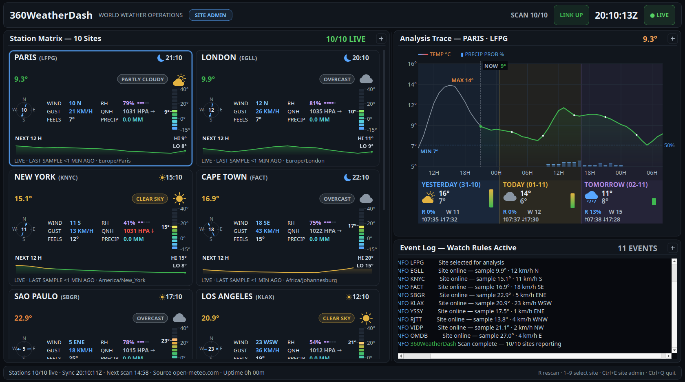

# 360WeatherDash — World Weather Operations Console

A Qt 6 / C++20 desktop application: a world weather dashboard styled as
a NOC instrument console — captioned instrument panels, a "measured,
never invented" data discipline, charcoal-blue chassis, white headline
values, muted gray labels, and one saturated accent per data domain:
temperature amber/orange, wind & precipitation blue, humidity violet,
pressure & status green, storms purple, critical red.



## What it does

- **Station matrix**: 12 world sites (Reykjavik → Sydney) as
  rounded instrument tiles. Each tile shows station code (ICAO-style),
  local clock with day/night indicator, white headline temperature,
  condition chip outlined in its domain color (amber clear, blue rain,
  cyan snow, purple storm), a segmented vertical temperature gauge with a
  cold-blue → hot-red ramp, two-tone line-art WMO glyph, wind compass with
  vector arrow, gusts, feels-like, segmented humidity blocks, sea-level
  pressure with 3 h trend arrow (green rising / red falling), precipitation,
  a +12 h temperature sparkline with gradient area fill, and a blinking
  status LED with data age.
- **Analysis trace**: multi-series chart for the selected site —
  trailing 12 h (gray) + next 36 h (orange with gradient area fill) of
  temperature, blue precipitation-probability histogram, subtle solid
  graticule, dashed NOW cursor with chip readout, MIN/MAX annotations, and
  a 3-day outlook strip (glyphs, cold→hot gradient range bars, rain
  probability, peak wind, sunrise/sunset). The panel headline shows the
  selected site's current temperature.
- **Event log**: timestamped (UTC) NOC log with raise/clear watch
  rules — high wind, gusts, heavy precipitation, thunderstorms, snowfall,
  heat/cold, low/falling pressure. Alerts log on raise, on severity change ("raised to CRITICAL" / "lowered to WARNING") **and** on clearing
  ("…NOMINAL"), severity color-coded (INFO/WARN/CRIT).
- **Header**: white masthead over a muted subtitle, ticking UTC clock,
  outlined green chips for LINK and LIVE (dot blinks), scan progress
  (`SCAN n/12`), feed link status — chips flip to red/amber on failure.
- **Status bar**: live-station count, last full sync, next-scan countdown,
  data source, uptime, hotkeys.

### Monitoring-room behaviors

- **Staggered scan cycle**: sites are polled round-robin (450 ms apart),
  like a NOC polling telemetry stations; a scheduled sweep runs automatically
  every 15 minutes (and on demand via `R`).
- **Measured, never invented**: pending sites render explicit dashed
  placeholders ("AWAITING FIRST SCAN"); missing samples render gaps, never
  zero. Network failure keeps the last good sample flagged STALE with a
  growing data age.
- **Link-down drill**: run with `--offline` to see the failure semantics
  without touching the network.

## Data source

Live data from the free [Open-Meteo](https://open-meteo.com) API — no API
key required. Each site fetches current conditions, hourly temperature /
precipitation-probability / MSL pressure (past 1 day + next 3 days), and a
daily outlook with sunrise/sunset.

## Build & run

Requires Qt 6 (Widgets + Network), CMake ≥ 3.21, a C++20 compiler.

```bash
cmake -B build -DCMAKE_BUILD_TYPE=Release
cmake --build build -j
./build/360WeatherDash
```

Useful flags:

```bash
./build/360WeatherDash --offline            # link-down drill, no network calls
./build/360WeatherDash --grab frame.png     # render one frame after the first scan, then exit
./build/360WeatherDash --help
```

## Packaging

One-liners, each run from the repo root with Docker installed (images build on first
use). Artifacts land in `dist/` (gitignored).

| Target | Command | Artifact |
|---|---|---|
| Linux x86_64 | `packaging/linux/build-linux.sh` | `dist/360WeatherDash-1.0.0-linux-x86_64.tar.gz` |
| Windows 10/11 x64 | `packaging/windows/build-win64.sh` | `dist/360WeatherDash-1.0.0-win64.zip` |
| macOS arm64 | `packaging/macos/build-macos.sh` | `dist/360WeatherDash-1.0.0-macos-arm64.zip` |

The Linux tarball is self-contained (Qt libraries and plugins bundled): extract it and
run `./360WeatherDash-1.0.0-linux-x86_64/360WeatherDash`. It is built on Fedora 43, so
the host needs glibc ≥ 2.42. Run `./360WeatherDash-1.0.0-linux-x86_64/install-desktop.sh` once to
add the launcher entry and app icon to your dock/app menu (a plain `cmake --install` does
the same). The Windows `.exe` embeds the app icon. The icon itself is painted by
`src/AppIcon.h`; the packaging scripts render it via `packaging/common/gen-icons.sh`. The macOS build is ad-hoc signed and not notarized.

### Hotkeys

| Key       | Action                          |
|-----------|---------------------------------|
| `R`       | Manual rescan                   |
| `1`–`9`   | Select station for analysis     |
| `Ctrl+Q`  | Quit                            |

Clicking any station card also selects it for the analysis trace.

## Layout

```
src/
  main.cpp             CLI, screenshot mode
  MainWindow.cpp/.h    console assembly, timers, alert bookkeeping
  WeatherService.cpp/.h Open-Meteo client, staggered scanner
  StationCard.cpp/.h   per-site instrument tile (fully custom-painted)
  EventLog.cpp/.h      NOC-style colored log
  StationData.h        data model, WMO table, watch rules, site list
  Theme.h              dark multi-accent palette + sans typography
  widgets/Panel.cpp/.h captioned framed panel
  widgets/TrendChart.cpp/.h scope trace + daily strip
  widgets/WeatherGlyph.h line-art weather glyphs
```

Everything is custom-painted with QPainter — no stylesheets for the
instrument surfaces, no bitmap assets.
